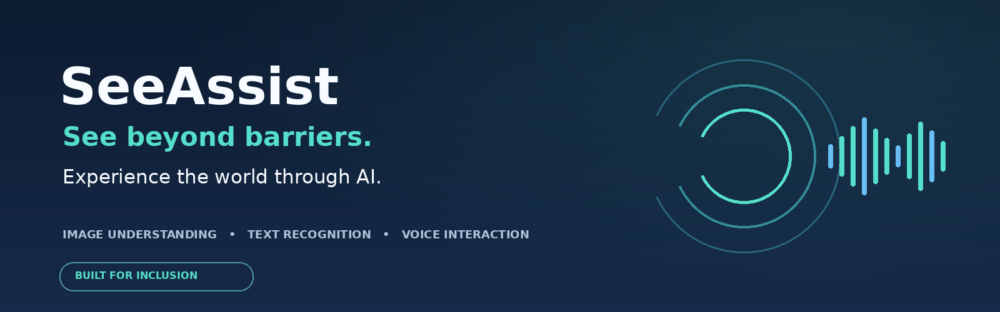
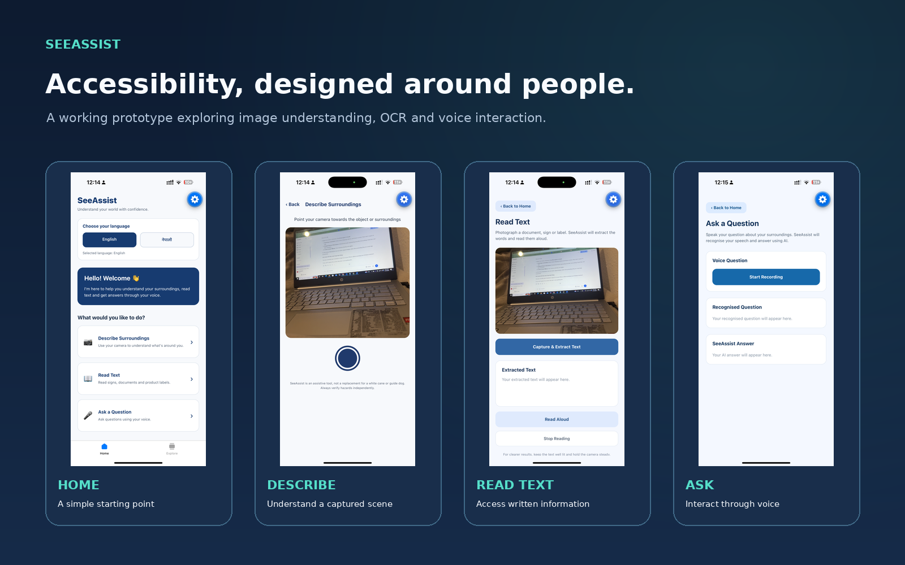
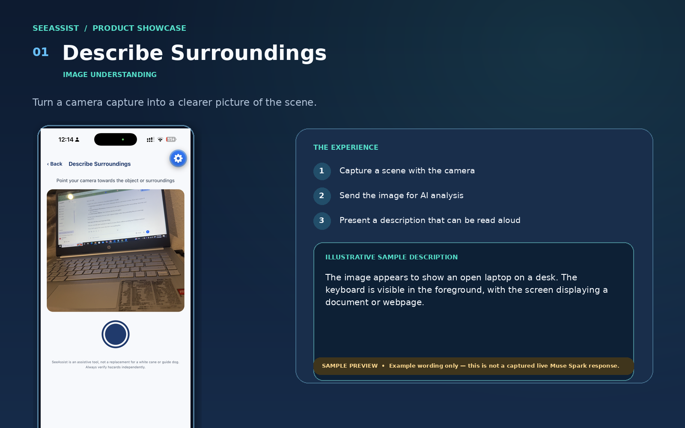
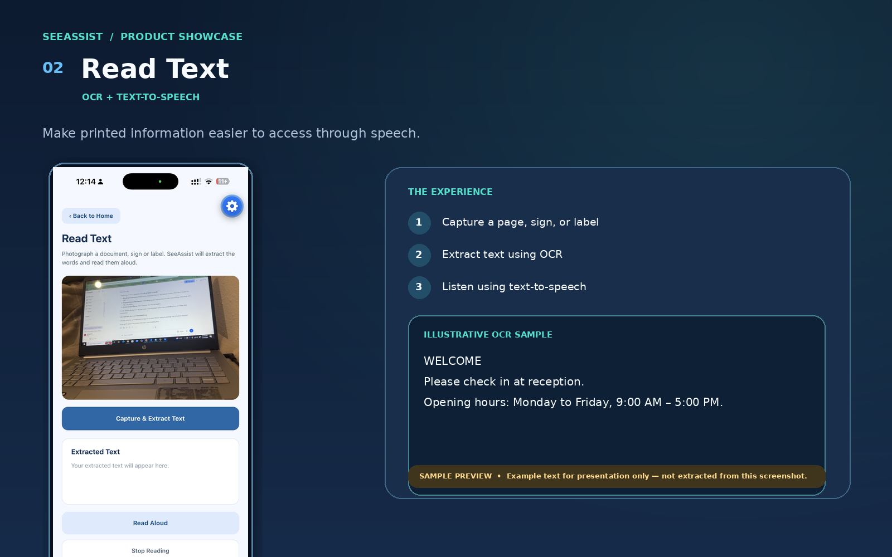
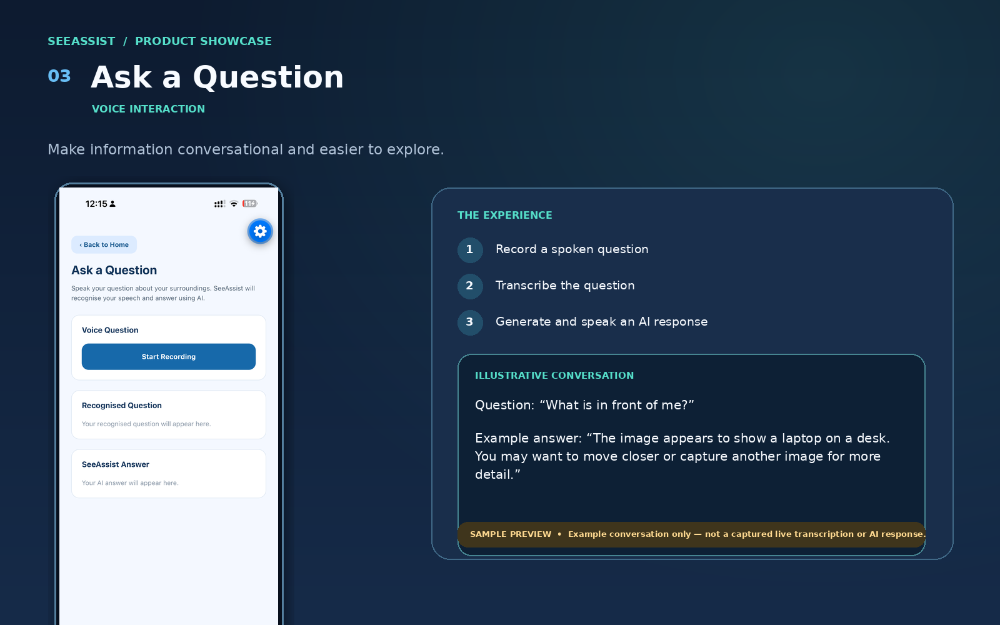

# SeeAssist
### See beyond barriers. Experience the world through AI.

<p align="center">
  
</p>

<p align="center">
  <strong>AI-powered accessibility · Image understanding · Text recognition · Voice interaction</strong>
</p>

<p align="center">
  Built for inclusion. Designed around people. Powered by AI.
</p>

---

## 🌍 About the project

**What if accessing everyday information didn't have to depend on sight?**

A printed page, an unfamiliar environment, or a simple everyday object can present barriers for people with visual impairments.

SeeAssist is an AI-powered mobile accessibility assistant exploring how image understanding, optical character recognition (OCR), and voice interaction can help make visual information more accessible.

Developed for the **Meta Global AI Developer Hackathon**, SeeAssist brings together Meta AI capabilities and mobile technologies to explore a more inclusive way of interacting with the world.

The idea is simple:

**Make information easier to access, understand, and hear.**

## 📱 SeeAssist in action

The following images showcase the actual SeeAssist iPhone interface and its main application screens.

<p align="center">
  
</p>

## ✨ Core features

### 👁️ 1. Describe Surroundings

Turn a camera capture into an AI-generated description.

- Capture an image using the mobile camera.
- Send the image for analysis using Meta Muse Spark.
- Display the generated description.
- Listen to the result using text-to-speech.
- Retake an image when needed.

<p align="center">
  
</p>

### 📖 2. Read Text

Make printed information easier to access.

- Capture printed text using the camera.
- Extract text using Tesseract OCR.
- Display the recognised text.
- Read the extracted text aloud.
- Stop speech when needed.

<p align="center">
  
</p>

### 🎙️ 3. Ask a Question

Explore information through voice interaction.

- Record a spoken question.
- Integrate Meta Muse Voice Transcribe for voice transcription.
- Send the question for an AI-powered response.
- Display and speak the response.

<p align="center">
  
</p>

### 🌐 4. English and Nepali interface

SeeAssist includes English and Nepali interface options.

The project explores language inclusivity by allowing users to interact with the application in a preferred interface language. AI response language and speech availability depend on the connected services and device support.

---

## ❤️ The purpose behind the project

SeeAssist is about more than recognising objects or converting text into speech.

It is about everyday moments:

- Understanding what is around you.
- Accessing printed information more independently.
- Asking questions naturally.
- Making technology more welcoming to people with different accessibility needs.

My ambition is to explore how AI can support independence, confidence, and inclusion.

**The value of AI should not only be measured by what it can generate, but also by the people it can help.**

---

## 🧠 Technology stack

| Technology | Role |
|---|---|
| React Native | Mobile application |
| Expo | Mobile development and testing |
| TypeScript | Application development |
| Expo Router | Navigation |
| Expo Camera | Camera capture |
| Meta Muse Spark | Image understanding and AI responses |
| Meta Muse Voice Transcribe | Voice transcription integration |
| Tesseract OCR | Text extraction |
| Expo Speech | Text-to-speech |
| Node.js | Backend services |

---

## 🏗️ Application architecture

```text
                  USER
                    │
                    ▼
             SEEASSIST APP
                    │
          ┌─────────┼──────────┐
          │         │          │
          ▼         ▼          ▼
        CAMERA     OCR        VOICE
          │         │          │
          ▼         ▼          ▼
     MUSE SPARK  EXTRACTED  TRANSCRIPTION
          │       TEXT          │
          ▼         │            ▼
     DESCRIPTION    │       AI RESPONSE
          │         │            │
          └─────────┼────────────┘
                    ▼
               EXPO SPEECH
                    │
                    ▼
             SPOKEN FEEDBACK
```

---

## 🚀 Getting started

### Prerequisites

- Node.js and npm.
- Expo Go on an iPhone, or a compatible iOS development environment.
- Meta API credentials and access to the required Muse services.
- A computer and iPhone that can communicate over the same local network when using LAN development.

### 1. Clone the repository

```bash
git clone https://github.com/YOUR-USERNAME/YOUR-REPOSITORY.git
cd ai-accessibility-assistant
```

Replace the example GitHub address with the actual public repository URL.

### 2. Install dependencies

From the project root:

```bash
npm install
```

### 3. Configure the backend

Create a local environment file in the `backend` directory:

```text
backend/.env
```

Add the Meta API credentials using the exact environment variable names expected by `backend/server.js`.

**Important:** Never commit `.env` files, API keys, access tokens, or private credentials.

### 4. Start the backend

Open a terminal:

```bash
cd backend
node server.js
```

### 5. Start the mobile application

Open a second terminal in the project root:

```bash
npx expo start --lan
```

Open Expo Go on your iPhone and scan the QR code.

Ensure the backend address configured in the application points to the computer's reachable local network address.

---

## 🔐 Accessibility, privacy and responsible AI

SeeAssist is an evolving assistive prototype.

Development priorities include:

- Simple navigation and accessible interactions.
- Voice-based access to information.
- Language inclusivity.
- Protection of API credentials.
- Awareness of the limitations of AI-generated descriptions and OCR.

AI outputs may be inaccurate or incomplete. SeeAssist is not a certified safety system and should not replace established accessibility tools or independent safety judgement.

## 🔭 Future development

The longer-term vision includes:

- More reliable multilingual OCR.
- Expanded language and voice support.
- Improved descriptions of everyday environments.
- Testing with people with visual impairments.
- Feedback-driven accessibility improvements.
- Greater reliability, privacy, and usability.

The next stage is not simply adding more AI features. It is understanding real user needs and building around them.

---

## 🏆 Meta Global AI Developer Hackathon

SeeAssist was developed for the Meta Global AI Developer Hackathon to explore how Meta AI technology can be applied to a meaningful accessibility challenge.

This project reflects my interest in combining emerging AI capabilities with practical, human-centred problem solving.

I believe the future of AI should be more than intelligent. It should be inclusive, useful, and accessible.

---

## 🤝 Connect and collaborate

I welcome:

- Feedback from the accessibility community.
- Collaboration with AI developers and researchers.
- Mentorship and learning opportunities.
- Opportunities to contribute to AI and accessibility initiatives.
- Future opportunities in AI engineering and inclusive technology.

I am particularly interested in contributing to teams where AI, accessibility, and meaningful real-world impact come together.

**If you believe technology should make the world more accessible, let's connect.**

---

<p align="center">
  <strong>SeeAssist — See beyond barriers.</strong><br/>
  <em>Built with curiosity. Driven by inclusion. Powered by AI.</em>
</p>

---

### Screenshot and sample-output note

The application screenshots in this repository are genuine captures of the SeeAssist interface. Any example descriptions or conversations added to showcase graphics are illustrative samples, not representations of newly recorded live API responses.